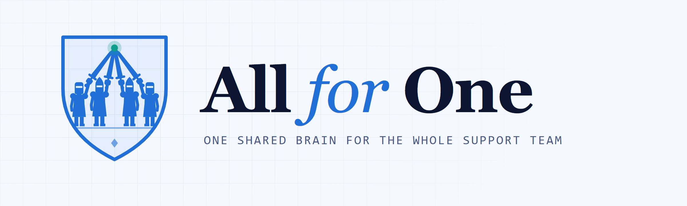
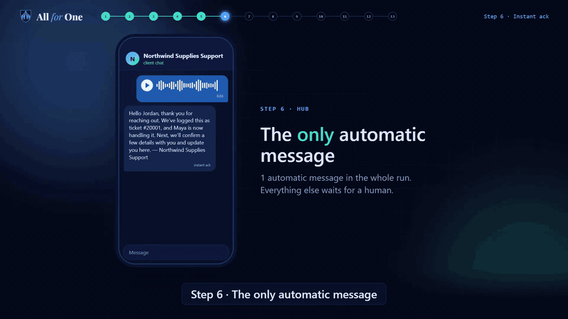
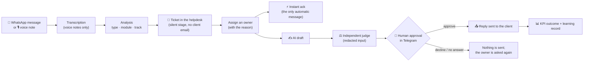
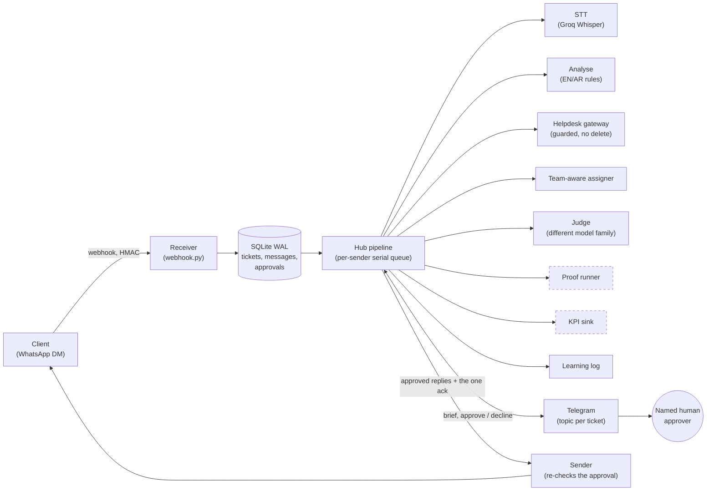

<div align="center">


# All for One

**A self-hosted support hub that turns WhatsApp messages and voice notes into helpdesk tickets, lets AI draft the replies, and sends nothing until a named human approves it.**

[](https://github.com/Shadysmetools/all-for-one-hub/actions/workflows/ci.yml)
[](LICENSE)
[](https://www.python.org/)
[](desktop/)

<picture>
  <source media="(prefers-color-scheme: dark)" srcset="assets/brand/hero-dark.png">
  
</picture>

<a href="assets/demo.mp4"></a>

<sub>Click the GIF for the full 85-second video. Everything in it is synthetic: a fictional company (Northwind Supplies), a fictional team (Alex, Maya, Sam) and a reserved test phone number. It runs entirely on fakes.</sub>

<br/>

⭐ **If this is useful to you, a star helps other support teams find it.**

</div>

---

> **Status: Phase 1 (pre-1.0).** The whole client loop runs end to end on fakes and is covered by tests. Several real adapters are written (Groq STT, Vertex judge, Telegram approvals, WhatsApp Cloud, read-only Odoo, ElevenLabs TTS), but the production entry point that wires them together is not built yet. With a key missing, an adapter returns `blocked` with a reason, never a fake result.

## Why

Small support teams that serve clients over WhatsApp lose time in the same places:

- **Voice notes and chat threads never become tickets.** Someone retypes them, or they get lost.
- **Replies are inconsistent.** Language, tone and promises depend on who answered and how busy they were.
- **AI drafting helps until it sends something wrong.** One confident, wrong message to a client costs more than the time it saved.
- **Nobody can say who did what.** Response times, reopen rates and proof that a fix works live in people's heads.

All for One turns each client message into a structured ticket and drafts the reply. A second, independent model scores the draft, and **a named human approves it before anything is sent**. Every step is logged, attributed to a person and fed back, so the next ticket is routed and drafted better.

## Features

| | Feature | Status |
|---|---|---|
| 📥 | **WhatsApp intake.** Text and voice notes arrive through a webhook. The Meta HMAC is checked on the raw bytes, and every message in a batch is stored before the hub answers 200. | beta |
| 🎙️ | **Speech to text.** Voice notes are transcribed with Groq Whisper and attached to the ticket. | adapter + fake |
| 🧭 | **Analysis.** Each request is classified as a bug, feature or inquiry, with a module and a track. Phase 1 uses deterministic EN/AR keyword rules. | beta (rules) |
| 🎫 | **One ticket per issue.** Tickets are keyed per issue, not per phone number. A reply within `reopen_days` asks the owner: reopen, or a new issue? | beta |
| 👥 | **Team-aware assignment.** The owner is picked from skills, role, track and open load, with an "assigned to Maya because…" rationale. | beta |
| ⚡ | **Instant acknowledgement.** One templated ack per ticket, in the client's language. It is the only message the hub ever sends without approval. | beta |
| ✍️ | **Drafted replies.** Confirm-understanding and resolution drafts from bilingual EN/AR templates, right-to-left for Arabic. | beta |
| ⚖️ | **Independent judge.** Each draft is redacted, then scored on correctness, tone, language, policy and completeness by a model from a different family than the drafter. | adapter + fake |
| ✅ | **Human approval in Telegram.** Approve or decline from inline buttons; a declined draft goes back to the owner. Each approval is bound to a person, a ticket, a draft and a single-use nonce. | adapter + fake |
| 🎬 | **Proof runs.** A runner interface reproduces the issue and attaches a proof video to the resolution. | interface + fake |
| 📊 | **Per-person KPIs.** Each resolved ticket emits an outcome attributed to its owner. | beta (fake sink) |
| 🔁 | **Learning from corrections.** Reassignments, edits, ratings and proof outcomes become learning records, and a review job proposes changes for a human to accept. | beta |
| 🗣️ | **One, the desktop teammate.** An optional Tauri app (`desktop/`): talk to Claude Code hands-free, see the team board and the approval queue. | experimental |

## Request flow



## Architecture



Every connector follows the same **interface + fake** pattern, so CI runs the whole loop with zero credentials. Dashed boxes have an interface and a fake but no real adapter yet. Production never falls back to a fake silently.

## Quickstart

Requires Python 3.11+. No accounts or keys are needed.

```bash
git clone https://github.com/Shadysmetools/all-for-one-hub.git && cd all-for-one-hub
python -m venv .venv && . .venv/bin/activate        # Windows: .venv\Scripts\activate
pip install -e ".[dev]"
python -m allforone.demo                             # the full 13-step loop on fakes
```

The demo prints each stage: the voice note, transcript, analysis, ticket, assignment with its reason, the ack, the judged draft, the approval, the proof run, the resolution and the KPI outcome. Add `--lang ar` for the Arabic flow.

Then run the tests and a dry-run of the hub's timer tick:

```bash
python -m pytest -q
python -m allforone.tick --dry-run
```

**Using real adapters.** Copy `.env.example` to `.env`, fill in only the keys you use, and export them into your shell (`set -a; . ./.env; set +a`). The hub does not read `.env` by itself. Each adapter can be built and tested on its own; see the docstrings in `src/allforone/adapters/`, `channels/`, `helpdesk/` and `tts/`.

## Configuration

Non-secret settings live in one YAML file (`cp config.example.yaml config.yaml`). Secrets never go in it.

| Key | What it does | Example |
|---|---|---|
| `company` | Name used in reply signatures ("… Support") | `Northwind Supplies` |
| `run_mode` | `dry_run`, `test` or `live`. Real writes and sends need `live`. | `dry_run` |
| `phone_number_id` | Your WhatsApp Business phone number id (not the number) | `YOUR_PHONE_NUMBER_ID` |
| `window_hours` | WhatsApp customer-service window | `24` |
| `reopen_days` | A reply within N days of resolve asks the owner: reopen or new issue | `7` |
| `approval_ttl_hours` | How long a pending approval stays valid | `24` |
| `approver_tg_ids` | Telegram ids allowed to approve any ticket (the ticket owner always can) | `[1001]` |
| `whatsapp.allowed_recipients` | Fail-closed allowlist of numbers the hub may ever message | `["+1-555-0100"]` |
| `helpdesk.write_enabled` | Real helpdesk writes (also need `run_mode: live`) | `false` |
| `helpdesk.safe_stage_ids` | Helpdesk stages that never email the client | `[901, 902, 903]` |
| `team` | Members with uid, Telegram id, role, skills and tracks | see the file |
| `routing.weights` | Weights for client ownership, module, type, role fit and load | see the file |
| `modules` | EN/AR keyword glossary for module detection | see the file |

Environment variables (see `.env.example`):

| Variable | Used by |
|---|---|
| `GROQ_API_KEY` | Speech to text (`adapters/groq_stt.py`) |
| `VERTEX_PROJECT` | Judge on Vertex AI (`adapters/vertex.py`), with Application Default Credentials |
| `ODOO_URL`, `ODOO_DB`, `ODOO_LOGIN`, `ODOO_API_KEY` | Read-only Odoo helpdesk adapter |
| `ELEVENLABS_API_KEY` | Text to speech (`tts/elevenlabs.py`) |
| `WHATSAPP_TOKEN`, `WHATSAPP_APP_SECRET`, `WHATSAPP_VERIFY_TOKEN`, `TELEGRAM_BOT_TOKEN` | Reserved for the production entry point (not wired yet) |
| `AFO_ADMIN_HOST`, `AFO_HUB_TOKEN_FILE`, `ONE_CLAUDE_BIN` | The desktop app (`desktop/`) |

## The human-in-the-loop safety model

| Rule | How it is enforced |
|---|---|
| **A human approves every reply** | The templated ack is the only automatic client message, at most one per ticket. Every other send needs a bound approval. |
| **Approvals are bound and single use** | Each approval is tied to an allowlisted approver (fails closed), the ticket, the message kind, the draft hash, a nonce and an expiry. Telegram buttons carry only the nonce, so nothing echoed back can change what is sent. |
| **No guessing when the judge is down** | A blocked or failing judge marks the draft **unjudged** and flags it for the human. It never invents a score. |
| **Verified webhooks** | `X-Hub-Signature-256` is checked on the raw body with a constant-time compare, before parsing. |
| **No-delete helpdesk guard** | Allowlisted models and methods only, no `unlink`, mail suppressed on create, writes off by default. |
| **Redaction** | Names, phones, emails and tokens are replaced before every judge call. Learning records store the partner id, never the phone number. |
| **No duplicate sends** | A send whose result is unknown is never retried automatically. |
| **Fail closed on recipients** | Only numbers in `allowed_recipients` can ever be messaged. |
| **Kill switch hook** | The WhatsApp sender checks a kill-switch callable before every send and refuses when it is on. |

The desktop app follows the same rule: it never approves anything itself. "Open to approve" opens the admin page for that ticket (`https://$AFO_ADMIN_HOST/tickets/<id>`), and a spoken "yes" never approves a tool call. See [desktop/README.md](desktop/README.md).

To report a vulnerability, see [SECURITY.md](SECURITY.md).

## Evals and testing

- **The judge is never the drafter.** Config pins a judge from a different model family, which avoids self-preference bias. A test asserts it.
- **Rubric scoring.** Correctness, tone, language match, policy (no promises on price, dates or scope; no internal names) and completeness, with a flag below the threshold.
- **Golden-set gate.** `EvalHarness` runs a redacted golden set (`src/allforone/fixtures/golden_set.json`) and fails on a regression in type accuracy, assignee accuracy or draft quality. Phase 1 runs it with the fake judge.
- **Exact match where ground truth exists.** Ticket type and assignee are scored against the human's final values, with no LLM.
- **Tests.** About 250 Python tests (`tests/`) cover the pipeline, approvals, webhooks, the guard, Arabic flows, retries and redaction. The desktop crate has about 300 Rust unit tests (`cd desktop/src-tauri && cargo test`).
- **PII scan.** `scripts/pii_scan.py` checks the tree for phone numbers, emails, IPs, token shapes and a private denylist. CI runs it with gitleaks, ruff and pytest on every push.

## Roadmap

**Phase 1: the core loop** (now)
- [x] Webhook intake with HMAC, durable SQLite state, per-sender queues
- [x] Per-issue tickets, reopen window, owner-chosen reopen or new issue
- [x] Bound, single-use approvals; bilingual templates; the one-ack rule; guarded helpdesk gateway
- [x] Team-aware assigner with rationale; learning log and review proposals
- [x] Judge and eval harness, redaction, a fake for every connector
- [x] Adapters for Groq STT, Vertex judge, Telegram approvals, WhatsApp Cloud, read-only Odoo, ElevenLabs
- [ ] A production entry point that wires the real adapters together
- [ ] Credentials backend, an operator kill-switch control, hash-chained audit log

**Phase 2: real deployments**
- [ ] Hub HTTP API for the desktop Tickets screen
- [ ] Approved-template sends outside the 24-hour window
- [ ] LLM analysis and drafting with Claude; DeepEval gate in CI
- [ ] Helpdesk write-back; KPI and BI sinks

**Desktop and voice** (experimental, in `desktop/`)
- [x] Hands-free voice chat with Claude Code, barge-in, call detection, approval cards
- [x] Team board and read-only Tickets screen
- [ ] Path-scoped approvals, macOS polish, live hub integration

## Contributing

PRs are welcome. Read [CONTRIBUTING.md](CONTRIBUTING.md) first. Every PR must:
- pass the tests, `ruff` and the PII scan (`scripts/pii_scan.py`);
- carry a DCO sign-off;
- contain **no real client data**.

Bug reports and feature requests have [issue templates](.github/ISSUE_TEMPLATE). Please follow the [Code of Conduct](CODE_OF_CONDUCT.md).

## License & commercial use

All for One is licensed under [Apache-2.0](LICENSE) (see [NOTICE](NOTICE)). It is **free for any use, including commercial use**: run it, modify it and ship it inside your own product.

If you want a **hosted version, custom integrations or priority support**, open an issue or get in touch through the maintainer's [GitHub profile](https://github.com/Shadysmetools).

**Trademark:** the "All for One" name and logo are reserved; see [TRADEMARK.md](TRADEMARK.md).

## Acknowledgements

- [Meta WhatsApp Cloud API](https://developers.facebook.com/docs/whatsapp/cloud-api), [Telegram Bot API](https://core.telegram.org/bots/api) and [Odoo](https://www.odoo.com/)
- [Groq](https://groq.com/) Whisper, [Anthropic Claude](https://www.anthropic.com/), [Google Gemini](https://ai.google.dev/) and [ElevenLabs](https://elevenlabs.io/)
- [Tauri](https://tauri.app/) and [SQLite](https://sqlite.org/)
